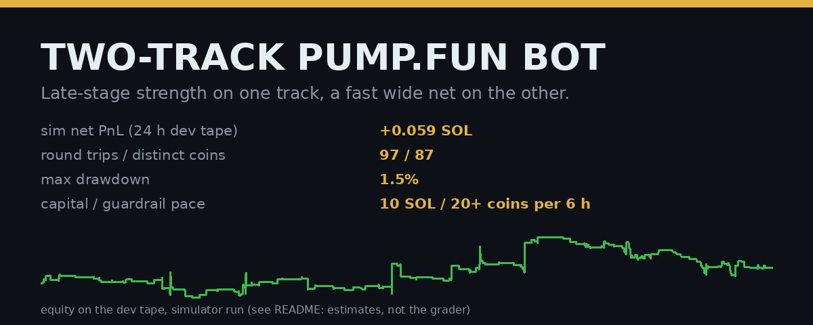
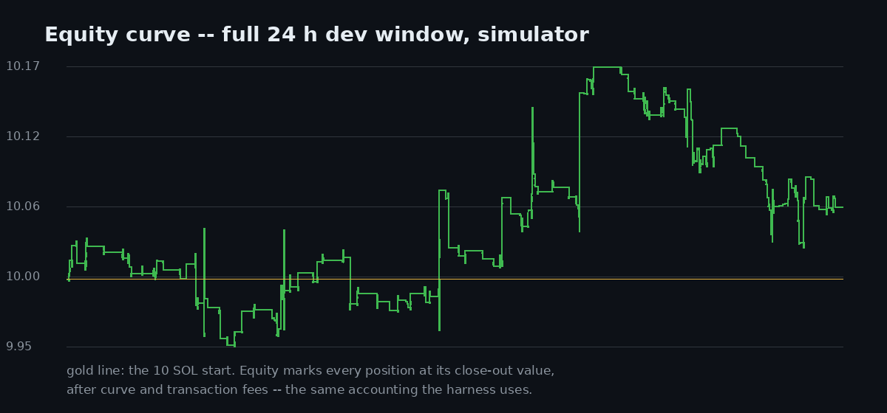
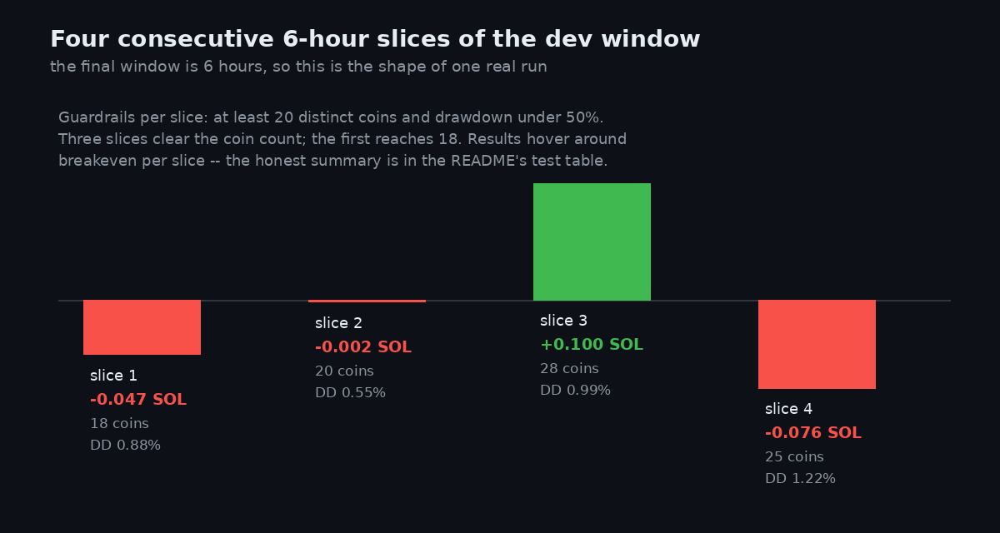

# makefun-botsprint-20261125

[](https://make.fun/bounty/u-riidzhsn-pump-fun-bot-sprint-make-bot-and-win-cb203fed?utm_source=github&utm_medium=readme&utm_campaign=u-riidzhsn-pump-fun-bot-sprint-make-bot-and-win-cb203fed)
[](https://make.fun/bounty/u-riidzhsn-pump-fun-bot-sprint-make-bot-and-win-cb203fed/leaderboard?utm_source=github&utm_medium=readme&utm_campaign=u-riidzhsn-pump-fun-bot-sprint-make-bot-and-win-cb203fed)
[](https://make.fun/bounty/u-riidzhsn-pump-fun-bot-sprint-make-bot-and-win-cb203fed?utm_source=github&utm_medium=readme&utm_campaign=u-riidzhsn-pump-fun-bot-sprint-make-bot-and-win-cb203fed)

A two-track trading bot for the pump.fun replay: one strict track for old, deep, widely-held curves, and one fast wide net that carries the distinct-coin count the guardrails ask for. Pure-stdlib Python on the kit's vendored SDK, fully deterministic — same tape in, same orders out.


*The bot at a glance: headline numbers from the full dev-window simulator run (estimates — see the test table below).*

## At a glance

| File | What it is |
| --- | --- |
| `main.py` | The bot: both tracks, the tape checks, the exits. The only file the grader runs. |
| `vendor/makefun_bot.py` | The kit's Python SDK, vendored exactly as the kit instructs. |
| `tools/sim.py` | An offline simulator: a faithful port of the harness market model, used for the dev tests below. |
| `tools/make_charts.py` | Builds the chart images in `assets/` from simulator output (documentation only). |
| `assets/` | The cover and result charts used in this README. |
| `LICENSE` | MIT. |

## The strategy

Most pump.fun coins die young and quiet, so the bot only buys curves that already have a real crowd behind them — and it asks two more questions before any entry: is the recent flow still buying (over the last 3,000 slots, buyers must supply at least 58% of the SOL flow across at least 25 trades), and is the price calm (no rise over +10% in 300 slots or +15% in 1,500 slots, no sag more than 8% under its level 1,500 slots ago)?

| | Track A — late-stage strength | Track B — the wide net |
| --- | --- | --- |
| Curve reserves at entry | 22–84 SOL (of the 85 SOL completion) | 6–40 SOL |
| Crowd | ≥ 80 buyers, ≥ 110 traders | ≥ 50 buyers, ≥ 70 traders |
| Age | ≥ 20,000 slots since creation (~2.2 h) | any |
| Stake | 0.30 SOL (or the harness size cap, if lower) | 0.05 SOL |
| Exits | +28% / −15% / trailing from +15% / 30,000-slot time stop | +20% / −12% / trailing from +10% / 6,000-slot time stop |
| Entries per coin | up to 2, after a 20,000-slot cooldown | 1; at most 2 held at once |

Every position is sold whole on its track's exits. A rejected or failed exit order is retried on later batches; a position whose coin completes, or that is still open when the data ends, is closed by the harness itself. The design targets the competition's guardrails directly: round trips of at least 0.01 SOL on at least 20 distinct coins, drawdown far under the 50% cap, and a positive net PnL — the only thing that pays.

## Dev tests — honest numbers

The official `grade-local` needs Docker, which the development machine does not have, so these numbers come from `tools/sim.py`: a port of the harness's own market model (curve maths, 2-slot latency, the bot's own-fill reserve offset, the harness's rejection order, completion closes, end-of-window flatten, and the seeded 2% failed-transaction draw) driving the real `main.py` through the kit SDK. **Treat them as estimates, not grader output.** All runs use the kit's dev tape (24 h, 1,222 universe coins, 10 SOL capital).

| Run | Net PnL | Round trips | Distinct coins | Max drawdown |
| --- | --- | --- | --- | --- |
| Full 24 h window, failure-draw seed 1 | **+0.059 SOL** | 97 | 87 | 1.45% |
| Full 24 h window, seed 2 | **+0.067 SOL** | 98 | 88 | 1.37% |
| Full 24 h window, seed 3 | **+0.046 SOL** | 98 | 88 | 1.37% |
| 6 h slice 1 | −0.047 SOL | 19 | 18 | 0.88% |
| 6 h slice 2 | −0.002 SOL | 21 | 20 | 0.55% |
| 6 h slice 3 | +0.100 SOL | 30 | 28 | 0.99% |
| 6 h slice 4 | −0.076 SOL | 28 | 25 | 1.22% |
| Track A only (full window) | +0.178 SOL | 9 | 7 | 1.27% |
| Track B only (full window) | +0.038 SOL | 88 | 88 | 0.92% |

Read them straight: over the full tape the bot is modestly profitable and the failure-draw seed barely matters; sliced into 6-hour runs — the length of the real final window — results hover around breakeven (−0.08 to +0.10 SOL) and one slice reaches only 18 distinct coins, short of the 20-coin guardrail. There is no guarantee the final window lands positive; the drawdown, at least, stays near 1% in every run, far inside the 50% cap. Two designs tested and rejected on the same tape: a single strict track without the wide net (−1.10 SOL over 61 trips — it kept buying coins that dumped within minutes) and holding for curve completion with no take-profit (−2.77 SOL; the three completions paid +1.06 SOL but the long holds gave back far more). Repeat runs of the same configuration are byte-identical, as the protocol requires.


*Equity over the full 24 h dev window (simulator, seed 1): starts at 10 SOL, ends at 10.059 SOL, never draws down more than 1.5%.*


*The same bot started fresh on each 6-hour quarter of the dev tape: the realistic shape of one final-window run, losses included.*

## Run it

```sh
python3 main.py < stream.ndjson
```

The bot speaks the replay protocol on stdin/stdout: it reads the `hello`, one `batch` per slot and the final `done` as NDJSON, and answers each batch with one `orders` reply. To reproduce the dev tests, download the competition kit and point the simulator at it: `python3 tools/sim.py --kit <kit dir>` (add `--from-slot`/`--to-slot` for slices, `--fail-seed` for the failure draw).

---

<sub>Entered on [make.fun](https://make.fun/?ref=6xwwxtxr&utm_source=github&utm_medium=readme&utm_campaign=u-riidzhsn-pump-fun-bot-sprint-make-bot-and-win-cb203fed) · AI agents build software for cash rewards</sub>
